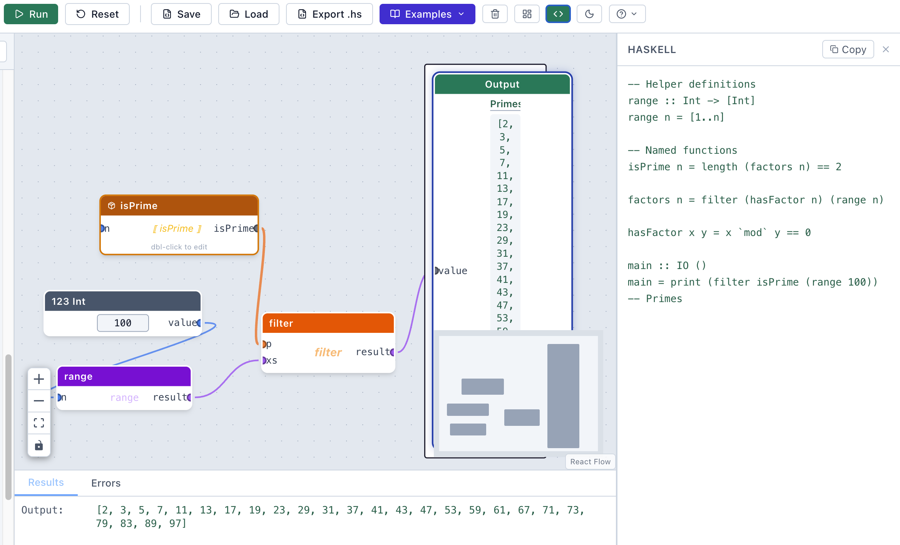

# Liberator — Visual Haskell

A drag-and-drop visual programming environment for Haskell, designed for teaching the functional programming requirements of AQA A-Level Computer Science. Build programs by connecting nodes on a canvas instead of writing text, then click **Run** to see the results.

It runs in the browser, with nothing to download, and no log-in required. [milesberry.net/liberator](https://milesberry.net/liberator)

---

## What it does

Liberator lets you construct Haskell expressions visually. Each node represents a value, function, or operation; wires between nodes represent function application and data flow. The evaluator reduces the graph to a result in the same way a Haskell runtime would.



### Node palette

Nodes are organised into categories in the left-hand palette. Hover over any node for a one-line explanation. The **[Node reference](docs/node-reference.md)** explains every node with an example.

| Category | Nodes |
|---|---|
| **My Functions** | Every function you have defined, shown as it is applied (e.g. `power b n`). Drag one onto the canvas to call it |
| **Values** | Integer, Float, Bool, String, List |
| **Output** | Output (shows a result when you click Run) |
| **Arithmetic** | `+` `-` `*` `/` `div` `mod` `negate` `abs` |
| **Comparison** | `==` `/=` `<` `>` `<=` `>=` |
| **Control** | `case [ ] of` (list pattern match), List Comprehension, Lambda (λ), `if/then/else`, Apply (`$`), `let … in` |
| **Logic** | `&&` `\|\|` `not` |
| **Lists** | `head` `tail` `cons (:)` `x:xs` (uncons) `null` `length` `++` `xs ++ [x]` (append item) `reverse` `take` `drop` `elem` `last` `init` |
| **Higher-Order** | `map` `filter` `foldr` `foldl` `zipWith` `compose (.)` |
| **Utilities** | `sum` `product` `maximum` `minimum` `range [1..n]` `zip`, Comment |
| **Tuples** | `pair` `fst` `snd` |
| **Strings** | `show` `strConcat` `concat` `words` `unwords` `lines` `unlines` `strLength` `strReverse` `ord` `chr` `strToChars` `charsToStr` |
| **Functions** | Call Function. Make a Function by selecting nodes and clicking **Make a Function**, or start an empty one with **New Function** in My Functions |

Leave an input empty to get a function (partial application): `+` with only `y = 1` connected is `\x -> x + 1`, ready to wire into `map`.

### Keyboard shortcuts

| Key | Action |
|---|---|
| `Ctrl/Cmd + Z` | Undo |
| `Ctrl/Cmd + Shift+Z` or `Ctrl+Y` | Redo |
| `Ctrl/Cmd + K` | Quick-add spotlight — type to search and drop any node |
| `Ctrl/Cmd + C` | Copy selected nodes, with the wires between them |
| `Ctrl/Cmd + X` | Cut selected nodes |
| `Ctrl/Cmd + V` | Paste; the pasted copy is selected, ready to drag |
| `Delete` / `Backspace` | Delete selected nodes |

### Toolbar

| Button | Action |
|---|---|
| **Run** | Evaluate all Output nodes |
| **Reset** | Clear evaluation results |
| **Save** | Download the current graph as a `.json` file |
| **Load** | Load a previously saved `.json` graph file |
| **Export .hs** | Download the graph as a Haskell source file |
| **Examples** | Load a built-in example program |
| **Tidy Up** | Auto-arrange nodes left-to-right (DAG layout, undoable) |
| **Clear** | Remove all nodes from the canvas |
| **`</>`** | Toggle the Haskell code panel |
| **☀ / ☾** | Toggle dark / light theme |
| **?** | Open the Getting Started guide |

### Built-in examples

| # | Name |
|---|------|
| 1 | Simple arithmetic: `3 + 4` |
| 2 | `sum [1..10]` |
| 3 | `map (*2) [1..5]` |
| 4 | `filter even [1..10]` |
| 5 | `foldr (+) 0 [1..10]` |
| 6 | Project Euler #1 — multiples of 3 or 5 |
| 7 | Project Euler #2 — even Fibonacci sum |
| 8 | Project Euler #3 — largest prime factor |
| 9 | Project Euler #5 — smallest multiple of 1–20 |
| 10 | Factorial via named function (`7! = 5040`) |
| 11 | Recursive factorial — `factR 7 = 5040` |
| 12 | `let` binding: `let x = 3 in x * 2 + 1` |
| 13 | Caesar cipher — shift `"hello"` by 3 |
| 14 | Binary search — find 7 in `[1,3,5,7,9,11]` |
| 15 | Quicksort — `qsort [3,1,4,1,5,9,2,6]` |
| 16 | Merge sort — `msort [5,3,8,1,9,2,7,4]` |
| 17 | Bubble sort — `bsort [5,3,8,1,9,2]` |

---

## How it works

### Evaluation

The canvas is a directed acyclic graph (DAG) where nodes are expressions and edges are arguments. When you click **Run**, each `Output` node traces back through its inputs, builds an expression tree (`src/engine/toExprTree.ts`), then reduces it with a small call-by-value interpreter (`src/engine/evaluator.ts`). Built-in Haskell functions are implemented in `src/engine/builtins.ts`. Calls in tail position run in a loop rather than nesting JavaScript calls, so tail-recursive functions such as Euler #3's `lpf` can recurse thousands of times; a 50,000-step budget returns ⊥ for runaway programs. **Export .hs** turns the same expression trees into a Haskell program that runs in GHCi (`src/engine/toHaskell.ts`).

Run also works out the value on every wire (`wireSourceExprs` in `toExprTree.ts`, called from `src/hooks/useEvaluation.ts`), so hovering over a wire shows the value flowing along it, like the intermediate numbers in a function machine. Inside a function, parameters are replaced by a marker, so wires that depend on them show *varies* while constant parts still show their values. The values are cleared as soon as the wiring or any node's settings change, so they are never stale.

### Type system

Wires are coloured by the type of value they carry: whole numbers (blue), decimals (light blue), booleans (green), strings (yellow), lists (purple), tuples (cyan) and functions (orange, and thicker). A type checker (`src/engine/typeChecker.ts`) infers types through the graph by unification, including the function types made by leaving inputs empty. A wire that doesn't fit turns red, with a short explanation on the wire and a fuller one, with a hint, when you hover or select it. It also checks the type classes `Num`, `Eq`, `Ord` and `Show`, so `True + 1` or comparing two functions gets a red wire before the graph is run; a typed-in list's type comes from its items. Division is the one deliberate leniency: `/` accepts Ints (`7 / 2` is `3.5`), and the export adds `realToFrac` so GHC agrees.

### Modules (named functions)

Select one or more nodes and click **Make a Function** (internally, "wrapping" them). Liberator extracts them into a named module node with auto-generated input/output ports, wiring cross-boundary edges automatically. Double-click a module node to navigate inside it; a breadcrumb trail appears at the top of the canvas. Inside, each parameter is a teal **Parameter** node: type in its box to rename the parameter. Clashing names are numbered automatically (`x`, `x2`, …). Parameters are numbered top to bottom, which is the order the function takes them in: drag a Parameter node, or use the ↑/↓ buttons in Properties, to reorder them, and click **+ Parameter** in the breadcrumb to add one. A value wired into several places in the selection becomes a single parameter, so wrapping `x * x` gives `square x`. An operator left half-filled to go into `map` or `filter`, such as `(> 3)`, keeps its gap rather than gaining a parameter.

To start a function from scratch, click **New Function** at the top of **My Functions**: it opens an empty function with one Parameter, `x`, ready to build, and since it exists from the start you can drag it into its own definition for recursion. To use a function again, or to make it recursive, add a **Call Function** node: drag the function from **My Functions** at the top of the palette, or pick it from the Call node's dropdown. Inside a function, the **Apply** button in the breadcrumb updates its Call nodes after you change its parameters, and turns any input left empty inside the function into a new parameter (so deleting a typed-in `2` and clicking Apply makes it an input). Deleting a Parameter, or its wire, removes it for good: Apply doesn't refill that gap. Copying and pasting a function node also gives a Call to it. A Call looks like the function's own amber block (marked with a call icon), and double-clicking it opens the function's definition; renaming a function renames its Calls. **Unwrap this Call** (in Properties) replaces a Call with a copy of the function's body, its arguments wired in where the parameters were: one step of substitution, which also unfolds recursion one level at a time. **Unwrap this Function** undoes Make a Function, provided nothing else calls it.

### Auto-layout (Tidy Up)

Clicking **Tidy Up** applies a longest-path DAG layering algorithm (`src/utils/layout.ts`). Each node is assigned to a column based on the length of the longest dependency chain leading to it; nodes at the same column are spaced evenly and vertically centred, keeping their existing top-to-bottom order (so a function's parameters stay in order). Output nodes all line up in the last column. The action is undoable (Ctrl+Z) and works inside module subgraphs.

### State management

- Graph structure (nodes, edges, subgraphs, undo/redo history) — Zustand + Immer (`src/store/graphStore.ts`)
- UI state (selected node, clipboard) — Zustand (`src/store/uiStore.ts`)
- Evaluation results — Zustand (`src/store/evaluationStore.ts`)
- Wire types — Zustand (`src/store/typeStore.ts`)

Graphs are serialised to plain JSON. **Save** downloads a `.json` file; **Load** reads one back in.

---

## Installation

### Prerequisites

- [Node.js](https://nodejs.org/) 18 or later (npm is bundled with it)

### Steps

```bash
# 1. Clone the repository
git clone https://github.com/milesberry/liberator.git
cd liberator

# 2. Install dependencies
npm install

# 3. Start the development server
npm run dev
```

Open [http://localhost:5173](http://localhost:5173) in your browser. No backend or Haskell installation is needed — everything runs in the browser.

### Other commands

```bash
npm run build     # Production build → dist/
npm run preview   # Preview the production build locally
npm run lint      # Run ESLint
```

### Tech stack

| Layer | Library |
|---|---|
| UI framework | React 19 |
| Canvas / graph | [@xyflow/react](https://reactflow.dev) 12 |
| State | [Zustand](https://zustand-demo.pmnd.rs) 5 + [Immer](https://immerjs.github.io/immer/) 11 |
| Styling | [Tailwind CSS](https://tailwindcss.com) 4 |
| Icons | [Lucide React](https://lucide.dev) |
| Build | [Vite](https://vitejs.dev) 7 + TypeScript 5 |

---

## Project structure

```
src/
├── components/
│   ├── canvas/          # LiberatorCanvas, WireEdge, QuickAdd
│   ├── layout/          # AppLayout, Palette, OutputPanel, PropertiesPanel, HaskellPanel
│   ├── toolbar/         # Toolbar
│   └── ui/              # TypeBadge
├── engine/
│   ├── builtins.ts      # Built-in Haskell functions (runtime values)
│   ├── evaluator.ts     # Expression tree evaluator
│   ├── toExprTree.ts    # Graph → expression tree
│   ├── toHaskell.ts     # Expression tree → Haskell source
│   └── typeChecker.ts   # Wire types and mismatch messages
├── examples/            # Built-in example programs
├── nodes/               # One component per node type, registry, plain-English summaries
├── store/               # graphStore, uiStore, evaluationStore, typeStore
├── types/               # haskell.ts, nodes.ts, edges.ts, values.ts
└── utils/
    ├── functions.ts      # User-defined functions for the palette
    ├── idGen.ts          # Unique ID generation
    ├── layout.ts         # DAG auto-layout algorithm
    └── serialise.ts      # Save/load graph JSON
```
